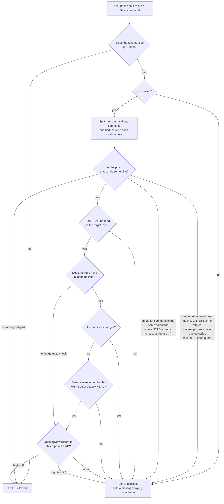

# `loopgate`

- [`loopgate`](#loopgate)
  - [What it is](#what-it-is)
  - [Why it exists](#why-it-exists)
  - [Where it fits](#where-it-fits)
  - [What is in it](#what-is-in-it)
  - [The key mechanism: the push hook](#the-key-mechanism-the-push-hook)
  - [Use it](#use-it)
  - [A worked example](#a-worked-example)
  - [What it is not, and how not to use it](#what-it-is-not-and-how-not-to-use-it)
  - [What it assumes, and what happens offline](#what-it-assumes-and-what-happens-offline)
  - [State](#state)
  - [Decisions](#decisions)
  - [References](#references)
  - [Licence](#licence)

## What it is

`loopgate` makes a coding agent prove its work before a pull request exists. A Claude Code push hook refuses `git push` until the repo's own checks have passed and an independent read-only review of the diff has been recorded for the exact commit, and a reusable GitHub workflow repeats a read-only review on the pull request.

It is for one developer who lets an AI assistant work across several small repos and wants those checks enforced by tooling instead of remembered. It never merges, approves or labels a pull request: everything it adds is read-only advice or a refusal, and the owner decides.

## Why it exists

A coding agent can produce a plausible diff faster than a person can read it. Left alone, three things go wrong:

1. The agent pushes before the checks pass, so CI fails on something it could have run itself.
2. Its own review of its own work misses what a second reader would catch.
3. The pull request becomes the first place anyone looks hard, and the person who merges pays for every round in attention.

Advice such as "run the tests before you push" gets skipped under time pressure, so `loopgate` turns it into a refusal the agent cannot talk its way past by accident: the push is blocked, with a message saying exactly what to run.

## Where it fits

The loop it enforces, from an edit to a merge. The shaded boxes are `loopgate`; the dashed box is whatever fast checks your repo already runs on edit and commit, which `loopgate` does not provide, and the plain boxes are git, GitHub and your own CI.

```mermaid
flowchart LR
    edit["Agent edits code"] --> own["Your own fast checks<br/>format on edit, pre-commit<br/>(not part of loopgate)"]
    own --> commit["git commit"]
    commit --> gates["ci-gate-runner<br/>runs the gates in loopgate.json"]
    gates -->|"a gate fails: fix, commit"| commit
    gates -->|"all pass: gate pass recorded for HEAD"| review["pre-push review<br/>read-only reviewer agent"]
    review -->|"high finding: fix, commit"| commit
    review -->|"no high finding: review recorded for HEAD"| push["Agent runs git push"]
    push --> hook{"Push hook<br/>reads both records"}
    hook -->|"a record is missing or stale: blocked"| gates
    hook -->|"both match HEAD: allowed"| pr["Pull request"]
    pr --> ci["Your CI: the same commands,<br/>kept in step by hand"]
    pr --> remote["Remote review workflow<br/>read-only, comments only"]
    remote --> triage["review-triage<br/>sorts the findings"]
    triage -->|"real defects: fix, commit"| commit
    ci --> merge["The owner reviews and merges"]
    triage --> merge

    classDef outside stroke-dasharray: 5 5
    classDef lg fill:#dbeafe,stroke:#1d4ed8,color:#111827
    class own outside
    class gates,review,hook,remote,triage lg
```



Two records connect the steps. `ci-gate-runner` writes a gate pass for the work tree and its `HEAD`; the review step writes a one-line review record for the repo and its `HEAD`. The push hook only reads them. A new commit changes `HEAD`, which makes both records stale, so every fix goes back through the gates and the review.

## What is in it

| Piece             | What it does                                                                                                                                                                                   |
| ----------------- | ---------------------------------------------------------------------------------------------------------------------------------------------------------------------------------------------- |
| `ci-gate-runner`  | Runs the repo's own gate commands from `loopgate.json` in order, stops at the first failure, and records a pass for the exact commit.                                                          |
| `pre-push-review` | Gathers the branch diff against `origin/main`, picks a model by risk, and hands the diff to a read-only reviewer agent that reports defects CI cannot catch. A `high` finding blocks the push. |
| `review-triage`   | Reads the findings the remote review left on a pull request and sorts them into real defects, noise and decisions only the owner can make.                                                     |
| Push hook         | A Claude Code `PreToolUse` hook on `Bash` that refuses `git push` until the gates passed and a review with no `high` finding is recorded for `HEAD`.                                           |
| Review workflow   | A reusable GitHub workflow that runs a read-only Claude review on each push to a same-repository, non-draft pull request.                                                                      |
| Agents and skills | Two read-only agents (`pre-push-reviewer`, `review-triage`: tools `Read`, `Grep`, `Glob` only) and the two skills that drive the tools. A test fails if an agent gains another tool.           |
| Library           | The small process and git helpers the tools share, for other packages. See [docs/library.md](docs/library.md).                                                                                 |

The tools are language-agnostic. They do not know what a test is; they run the commands in a repo's `loopgate.json`, so they gate a Python, Rust or JavaScript repo alike. Per-tool detail: [ci-gate-runner](docs/ci-gate-runner.md), [pre-push review](docs/pre-push-review.md), [review-triage](docs/review-triage.md).

## The key mechanism: the push hook

The hook is the part that makes the rest binding. Claude Code runs it before every `Bash` call; it exits `2` (block, with a message that goes back to Claude) or `0` (allow). It starts nothing: a hook has seconds, a gate run takes minutes, so it only reads the two records that the tools wrote earlier. That is why the first push attempt is blocked and the second goes through.



What each answer is read from, as the code does it:

- **The gate pass** is `ci-gate-pass.json` in the state directory: one entry per work-tree path holding the `HEAD` the gates passed at. It is checked only in a repo that has a `loopgate.json`, and an uncommitted change blocks, because the pass tested other code.
- **The review record** is `pre-push-review-log.jsonl`, one line per review. The hook takes the latest line whose `repo` equals the repo's name (the last path segment of the `origin` remote, else the directory name) and whose `head` starts with the first seven characters of `HEAD`. Its `high` count must be `0`. No such line blocks.
- **What blocks:** a missing or stale record, a `high` count above zero, a dirty tree (in a gated repo), no `jq`, an unreadable `HEAD`, a push whose target repo the hook cannot work out, and a push that comes after a command, in the same command line, that moves `HEAD`.
- **What allows:** both records match, or the command is not a push (or is `--dry-run` or `-n`).
- **What an override means.** The hook has no override switch. When it blocks on a `high` finding, its message says to fix it or "ask the owner to override". An override is the owner telling the assistant to record the review with `--high 0`; the skill says to do that only with the owner's yes and to say so in the pull request description. The record is then as good as the assistant's word, which is why CI and the owner's own read of the diff still come after it.

The hook reads commands, not intent. [ADR-0001](docs/adr/0001-ci-gate-runner.md) lists what the scanner handles and what it refuses rather than guess.

## Use it

Requires Node 24 or later and `git`. The hook also needs `jq`, and review triage needs `gh`.

```bash
git clone https://github.com/kangaliaisaac/loopgate
cd loopgate && npm ci
```

**What a repo adds.** `loopgate` itself is installed once, as a checkout (`<loopgate>` below). The repo you gate adds:

| File                                | Where                                 | Committed |
| ----------------------------------- | ------------------------------------- | --------- |
| `loopgate.json`                     | repo root                             | yes       |
| the push hook and `permissions.ask` | repo `.claude/settings.local.json`    | no        |
| `.github/workflows/review.yml`      | repo, a short caller                  | yes       |
| your CI workflow                    | repo `.github/workflows/`             | yes       |
| agents and skills (copy or symlink) | `~/.claude/` or the repo's `.claude/` | either    |

**1. Describe the gates.**

Put a `loopgate.json` at the root of the repo to gate (one per repo, committed there). It is read from the top level of the work tree only: no search upward, no global default. A repo without one has no gates, and the runner says so. This is `loopgate`'s own, which gates itself:

```json
{
	"gates": [
		{ "name": "prettier", "command": "npx", "args": ["prettier", "--check", "."] },
		{ "name": "typecheck", "command": "npm", "args": ["run", "typecheck"] },
		{ "name": "build", "command": "npm", "args": ["run", "build"] },
		{ "name": "test", "command": "npm", "args": ["test"] },
		{ "name": "audit", "command": "npm", "args": ["audit", "--audit-level=high"] },
		{ "name": "shellcheck", "command": "shellcheck", "args": ["hooks/pre-push-gate.sh"] }
	],
	"environment": { "path": "node_modules", "fix": "run `npm ci`" }
}
```

`environment` is optional: a path that must exist before any gate runs, so a fresh git worktree is told what to install instead of failing on every gate. The other optional keys (`timeoutMs`, `needsTestDb`, `testDatabaseEnv`, `siblingRepos`, `sensitivePaths`) are in [spec.md](spec.md). An invalid file is an error that names the key, never a silent default.

A Python repo gates like this (with `uv run --no-sync` so the gates work without the venv on `PATH`):

```json
{
	"gates": [
		{ "name": "ruff", "command": "uv", "args": ["run", "--no-sync", "ruff", "check", "."] },
		{
			"name": "format",
			"command": "uv",
			"args": ["run", "--no-sync", "ruff", "format", "--check", "."]
		},
		{ "name": "mypy", "command": "uv", "args": ["run", "--no-sync", "mypy", "src"] },
		{ "name": "test", "command": "uv", "args": ["run", "--no-sync", "pytest", "-q"] }
	]
}
```

**2. Run the tools** from the repo being gated:

```
node <loopgate>/bin/ci-gate-runner.ts
node <loopgate>/bin/pre-push-review.ts prepare
node <loopgate>/bin/review-triage.ts fetch --pr 12 --repo acme/my-agent
```

The runner records a pass per commit, so the repo needs at least one commit first, and it refuses a dirty tree.

**3. Install the agents and skills.**

Copy or symlink `agents/*.md` into `~/.claude/agents/` and `skills/*` into `~/.claude/skills/` (or into the repo's `.claude/`). The skills drive the tools and tell the assistant what to do with the results; the agents only read.

**4. Wire the hook.**

Add it to the repo's untracked `.claude/settings.local.json`. The hook refuses a push that is not ready; it does not ask. The `permissions.ask` entries make Claude Code stop for your yes before a `git push` or a `git -C <dir> push`, so you can read the commit messages and the change first. They match the command text: a `git push --dry-run` also stops, while a push with other flags between `git` and `push` (for example `git -c key=value push`) does not. The skill's last step also tells the assistant to ask. The two spellings are the ones [Claude Code's permissions page](https://code.claude.com/docs/en/permissions) documents (a `*` may sit anywhere in the rule):

```json
{
	"permissions": {
		"ask": ["Bash(git push *)", "Bash(git -C * push *)"]
	},
	"hooks": {
		"PreToolUse": [
			{
				"matcher": "Bash",
				"hooks": [
					{
						"type": "command",
						"command": "sh \"<loopgate>/hooks/pre-push-gate.sh\""
					}
				]
			}
		]
	}
}
```

**5. Turn on the remote review.**

Copy [docs/review-caller.example.yml](docs/review-caller.example.yml) into the repo as `.github/workflows/review.yml`, keep or bump the `@v0.1.0` tag, and add a `CLAUDE_CODE_OAUTH_TOKEN` repository secret and the Claude Code GitHub App. It reviews same-repository, non-draft pull requests with read-only tools, and skips Dependabot pull requests.

**6. Make CI the backstop.**

In GitHub, require the `review / review` check (the caller's job, then the reusable workflow's) and your gates on the branch. The hook cannot do that for you (see the next sections).

## A worked example

A repo `acme/my-agent` with two gates, `lint` and `test`, and a feature branch with one commit. Every output below comes from running the tools in a scratch repo; only the paths are shortened.

**The assistant tries to push straight away.** The hook has no gate pass for this commit:

```
Blocked: the gates have not passed for my-agent at b80e314. Run ci-gate-runner from '/work/my-agent' (it can take minutes: run it in the background and wait), then push again.
```

**It runs the gates.** One line per gate with its seconds, and a pointer to the next step:

```
$ node <loopgate>/bin/ci-gate-runner.ts
ok lint (0s)
ok test (0s)
All gates passed for my-agent at b80e314.
Next: run the pre-push review (skill `pre-push-review`), then push.
```

A failing gate stops the run, prints `FAILED <name> (exit <code>, <seconds>s):` and the last 60 lines of its output, and exits `1`. Exit `2` means the runner could not run (for example a dirty tree, not a repo, a repo with no commit, a missing `environment` path, no `git`, invalid config).

**It tries again.** The gates pass, but no review is recorded:

```
Blocked: no pre-push review is recorded for my-agent at b80e314. Run the pre-push-review skill (prepare, review, handle the findings, log), then push again.
```

**It prepares the review.** `prepare` is a script with no model in it. It fetches, writes the diff of `HEAD` against `origin/main` to a file, and prints JSON:

```
$ node <loopgate>/bin/pre-push-review.ts prepare
{
  "repo": "my-agent",
  "branch": "feature",
  "head": "b80e314...",
  "commits": ["b80e314 Add gates"],
  "files": [ { "path": "loopgate.json", "added": 6, "deleted": 0 }, ... ],
  "lines": 7,
  "model": "sonnet",
  "reasons": [],
  "large": false,
  "diffPath": "<state dir>/pre-push-review/my-agent-b80e314.diff",
  "context": [],
  "warnings": []
}
```

(Trimmed here; it also prints `top`, `base`, and the rest of `files`.) The skill then starts the read-only `pre-push-reviewer` agent on that diff, with the stronger model when `model` says so. The agent ends with one line, for example `VERDICT: 1 high, 0 medium, 0 low`, and the skill logs those counts:

```
$ node <loopgate>/bin/pre-push-review.ts log --repo my-agent --head b80e314 --model sonnet --lines 7 --high 1 --medium 0 --low 0
Logged.
```

**A `high` finding blocks the push:**

```
Blocked: the latest pre-push review of my-agent at b80e314 recorded 1 high finding(s). Fix them, commit, run the gates and the review again; or ask the owner to override.
```

The assistant checks the finding itself (the reviewer can be wrong), fixes it in a new commit, and starts again: new `HEAD`, so new gates and a new review. When the review of the new commit finds no `high`, `log` records `--high 0` and the hook prints nothing and exits `0`: the push goes through.

**On the pull request**, your CI runs its own copy of the gates and the review workflow comments on the diff. When the `review / review` check finishes with findings, the assistant fetches them and has them sorted:

```
$ node <loopgate>/bin/review-triage.ts fetch --pr 12 --repo acme/my-agent
```

It prints a JSON summary (`path` to the findings file, `headSha`, counts of `findings`, `unverifiedClaims` and `stale`, and `warnings`). The `review-triage` agent reads the code each finding points at and ends with `TRIAGE: <d> defects, <n> noise, <o> owner decisions, <r> worth running`. It never replies to or resolves a comment. The owner reads, decides and merges.

## What it is not, and how not to use it

- **It is not a security boundary.** The hook reads the command Claude is about to run and refuses a push it can tell is unsafe. It is a scanner with known limits: a conditional `cd`, an alias, `echo '...' | sh`, and a `git`, `pushd` or `GIT_DIR` form hidden inside a quoted script can slip past it, and a command that merely mentions a push in its text can be refused. Treat it as a guardrail for an agent that is trying to follow the rules, not a defence against one that is not.
- **It is not a CI replacement, and it does not write or check your CI.** It runs the gate commands earlier and on one machine, so a failure costs seconds instead of a CI round. CI still has to run them, because a push that did not go through the hook (below) never had them checked, and keeping its commands in step with `loopgate.json` is the repo's job: nothing makes CI read `loopgate.json`. `loopgate`'s own CI repeats its gates by hand and already differs a little (it shellchecks every `*.sh` file where the gate checks one, and runs `gitleaks`, which is not a local gate).
- **It only covers pushes Claude makes.** A push from your own terminal, a script or another tool skips the hook. The hook also judges the checked-out `HEAD`, not the branch named in the command. Make CI the backstop: require the `review / review` check and the gates on the branch.
- **The review record is self-reported.** The assistant records the counts the reviewer printed; nothing proves the review ran, and nothing stops a false `--high 0`. The log shows the pattern over time, and the remote review and the owner are the backstop.
- **It is not a substitute for a human reading the diff.** The reviewer is a model: it can miss a defect and it can report one that is not there. It sees the diff and the repo it runs in, and is told to say what it could not check. The skill has the assistant verify every `high` and `medium` finding before acting. A clean review is not a reason to skip reading the change.
- **It cannot catch what the gates do not test.** The gates are exactly the commands in `loopgate.json`; a repo with weak tests has weak gates. The hook proves the gates passed for a commit, not that they were good.
- **It does not run for free.** Each pre-push review is a model call (the stronger model for a diff of 200 or more changed lines, or one that touches a decision record, `CLAUDE.md`, a workflow, or an agent, skill or hook definition). A diff of 1500 or more lines is flagged as too large to review well: split it or get the owner's yes first. After two rounds, the skill asks the owner whether to continue.
- **Do not run the gate runner on a repo you do not trust.** It runs the commands in that repo's `loopgate.json`, which can be anything.
- **Do not put secrets or private data in `loopgate.json`, gate output or the state records.** They are local and uncommitted, but they are plain files, and the reviewer reads whatever the diff contains. The diff files in the state directory contain your code; nothing uploads them except through the models that review them.
- **The remote review is narrow on purpose.** It reviews same-repository, non-draft pull requests with read-only tools, and skips Dependabot pull requests. It is not a general code scanner, and a pull request from a fork gets no review because forks get no secrets.
- **It advises and refuses; it never decides.** It does not merge, approve, label, reply to or resolve anything, and it does not fix the code it reviews: a fix is the author's call and a new commit.

## What it assumes, and what happens offline

- **Claude Code.** The hook, agents and skills are Claude Code features. The review models are Claude models (the stronger one for risky diffs, the cheaper one otherwise), and the remote review needs a Claude Code OAuth token as a repository secret.
- **Tooling.** Node 24 or later (the tools run from TypeScript source with no build step), `git`, `jq` for the hook, `gh` for review triage, and a POSIX shell with `awk`, `sed` and `grep` for the hook. Your gates bring their own tools: `loopgate`'s own need `shellcheck` and `npm`. Its CI also runs `gitleaks`, which is not a local gate. Nothing here has been tried on Windows.
- **A git history.** The runner records a pass for a commit, so the repo needs one. The review diffs against `origin/main`; if `origin/main` does not exist (a new remote, another default branch, no `origin`), `prepare` reviews the whole tree and says so in `warnings`.
- **Offline.**
  - The hook works offline: it reads local files and runs `git` locally.
  - `ci-gate-runner` works offline unless a gate needs the network (`npm audit` does).
  - `prepare` runs `git fetch` first. If that fails or times out it only warns that `origin/main` may be stale and the diff may include already-merged work; it does not stop. Every git call has a one-minute limit and credential prompts are off, so it fails instead of hanging.
  - The reviewer agent needs the model service, so no review can be recorded offline, and the hook will keep blocking until one is.
  - `review-triage` and the remote review need GitHub.
- **A missing `git` blocks rather than allows.** If `git` cannot be run, the runner exits `2` and runs nothing, and the hook blocks. A `git` that hangs is limited only in `prepare` (one minute); the runner and the hook set no time limit of their own. If the hook itself hangs, Claude Code's own hook timeout ends it; whether the push is then blocked is Claude Code's behaviour, not something this repo guarantees, so treat CI as the backstop.
- **A hung gate is stopped** after 20 minutes (or the gate's `timeoutMs`), with its last output.

## State

Records (gate passes, the review log, diffs, findings) are kept under `LOOPGATE_STATE_DIR`, by default `~/.local/state/loopgate`. They stay local and are never committed. The gate pass is keyed by the work tree's path; the review record by repo name and `HEAD`, so two clones of the same repo share review records but not gate passes. A repo is named after its `origin` remote's last path segment (`git@github.com:acme/my-agent.git` is `my-agent`), else its directory.

## Decisions

The decisions behind the design are in [docs/adr](docs/adr). The ones a reader is most likely to ask about:

| Question                                           | Answer                                                                                                                                                                    | Record                                         |
| -------------------------------------------------- | ------------------------------------------------------------------------------------------------------------------------------------------------------------------------- | ---------------------------------------------- |
| Why does the hook not just run the gates?          | A hook has seconds and a gate run takes minutes, so the hook reads a record that the runner wrote. One extra round trip buys a hook that never times out.                 | [ADR-0001](docs/adr/0001-ci-gate-runner.md)    |
| Why are the gates in each repo, not in `loopgate`? | So `loopgate` gates any language, and the gate list lives in the repo it gates, next to its CI.                                                                           | [ADR-0001](docs/adr/0001-ci-gate-runner.md)    |
| Why does a `high` finding block, and `medium` not? | A push that fails a CI gate or a review costs a round each, so a likely defect stops the push. Lesser findings are fixed or answered in the pull request.                 | [ADR-0002](docs/adr/0002-pre-push-reviewer.md) |
| Why is the review a fixed workflow, not an agent?  | The path is fixed (gather, route, review once, report). The reviewer does not feed a fixer: a fix is the author's decision and a new commit, which needs the gates again. | [ADR-0002](docs/adr/0002-pre-push-reviewer.md) |
| Why can the reviewer and the triager not edit?     | Their tools are `Read`, `Grep` and `Glob`, and a test fails if that changes. They advise; they cannot act on a finding or on text inside the diff.                        | [ADR-0003](docs/adr/0003-review-triage.md)     |
| How is GitHub kept read-only in triage?            | The script reaches GitHub only through an allowlist of `gh api` reads. Comments, merges, deletes and every write flag are refused before `gh` starts.                     | [ADR-0003](docs/adr/0003-review-triage.md)     |

[intent.md](intent.md) says what `loopgate` is for and what it will not do; [spec.md](spec.md) is the contract.

## References

The design rests on public work; the tools are an application of it, not a copy.

- Anthropic, [Building effective agents](https://www.anthropic.com/engineering/building-effective-agents): keep the human in the loop at checkpoints, stop on explicit conditions, and test agents in a sandbox before trusting them.
- Anthropic, [Effective harnesses for long-running agents](https://www.anthropic.com/engineering/effective-harnesses-for-long-running-agents): one change per session, a commit at the end of each, and end-to-end verification before something counts as done. This is the loop `loopgate` enforces.
- Anthropic, [Harness design for long-running application development](https://www.anthropic.com/engineering/harness-design-long-running-apps): a separate, deliberately skeptical evaluator beats an agent grading its own work. The pre-push reviewer plays that role.
- Claude Code, [Hooks reference](https://code.claude.com/docs/en/hooks): the `PreToolUse` hook and its exit-code semantics, which the push hook is built on.

## Licence

MIT. See [LICENSE](LICENSE).
